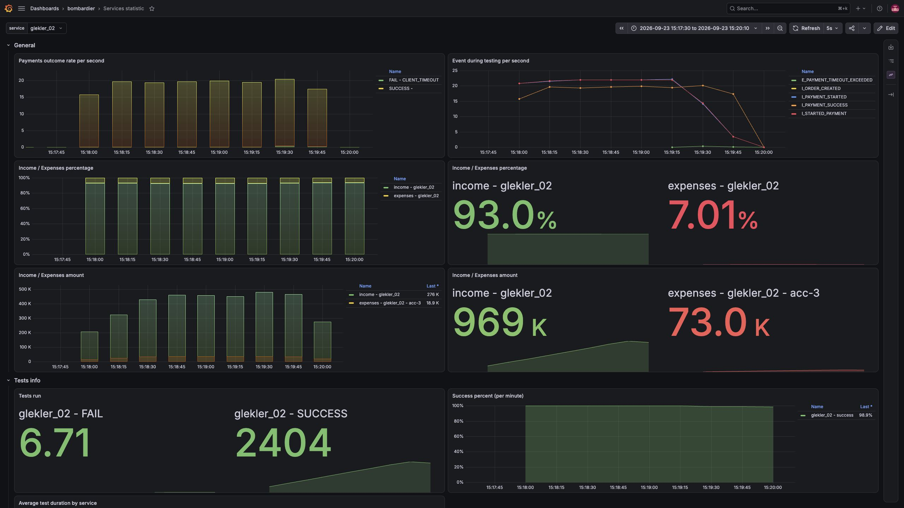
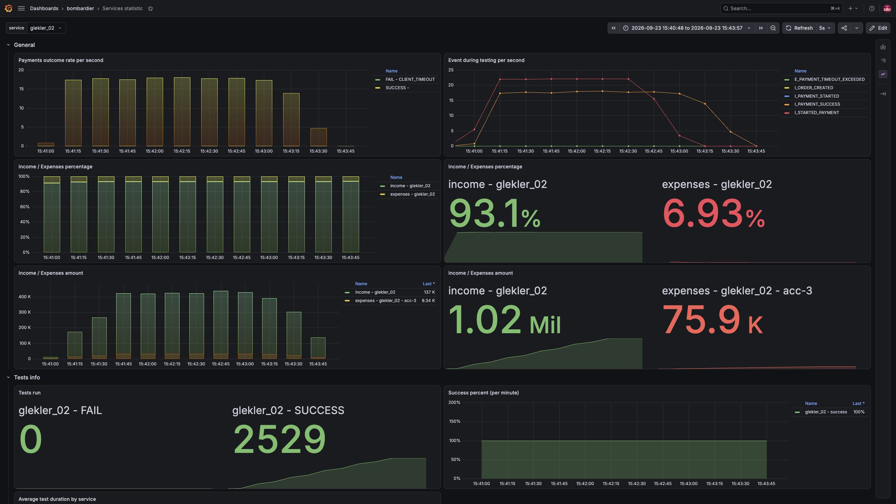
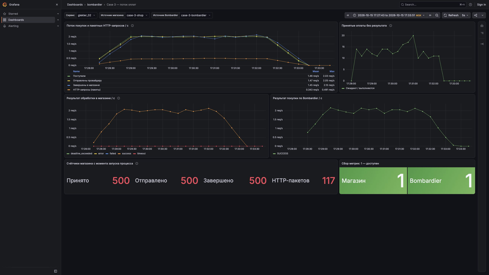

# Template for the HighLoad course
This project is based on [Tiny Event Sourcing library](https://github.com/andrsuh/tiny-event-sourcing)

### Run PostgreSql
This example uses Postgres as an implementation of the Event store. You can see it in `pom.xml`:

```
<dependency>
    <groupId>ru.quipy</groupId>
    <artifactId>tiny-postgres-event-store-spring-boot-starter</artifactId>
    <version>${tiny.es.version}</version>
</dependency>
```

Thus, you have to run Postgres in order to test this example. Postgres service is included in  `docker-compose` file that we have in the root of the project.

# More comprehensive information about the course, project, how to run tests is here:

https://andrsuh.notion.site/2595d535059281d8a815c2cb3875c376?source=copy_link

https://andrsuh.notion.site/2625d5350592801aaf88c7c95302d10c?source=copy_link

### Run the infrastructure
Set of the services you need to start developing and testing process is following:
- Bombardier - service that is in charge of emulation the store's clients activity (creates the incoming load). Also serves as a third-party payment system.
- Postgres DBMS
- Prometheus + Grafana - metrics collection and visualization services

You can run all beforementioned services by the following command:
```
docker compose -f docker-compose.yml up
```

### Run the application
To make the application run you can start the main class `OnlineShopApplication`. It is not being launched as a docker contained to simplify and speed up the devevopment process as it is easier for you to refactor the application and re-run it immediately in the IDE.


### If you want to pull changes from the main repository into your fork

The command ```git remote -v``` should include the following lines:

```
upstream        https://github.com/andrsuh/high-load-course.git (fetch)
upstream        https://github.com/andrsuh/high-load-course.git (push)
```

If not, add the upstream remote:
```git remote add upstream https://github.com/andrsuh/high-load-course.git```

To pull changes from the main repository, run the following commands:

```
git fetch upstream
# switch to the main branch of your fork. Make sure the branch has no uncommitted changes to avoid conflicts
git checkout main 
# merge changes from the main repository into your main branch
git merge upstream/main 
```

## Case 1

### Первый прогон



### После



## Case 3

`acc-5` · 2 покупки/с · 500 покупок · `processingTimeMillis = 60000`.

Оплаты отправляются через
`PUT /external/process/bulk`: до пяти покупок в одном запросе, накопление не более
двух секунд. Исходные дедлайны, суммы и лимиты аккаунта сохраняются.

Собственные счётчики `shop_payment_received_total`, `shop_payment_submitted_total`
и `shop_payment_completed_total` показывают поступившие, отправленные и завершённые
оплаты. `shop_payment_provider_requests_total` отдельно считает HTTP-пакеты.

**Локальный результат: 500/500 успешных покупок, 117 HTTP-запросов.**
Прогон 15.10.2026, 17:27:58–17:32:21 МСК; очередь завершена.



[Grafana на интервале прогона](http://127.0.0.1:13003/d/case-3-payments?from=1792074463433&to=1792074831536&var-service=glekler_02&var-shop_job=case-3-shop&var-provider_job=case-3-bombardier).
