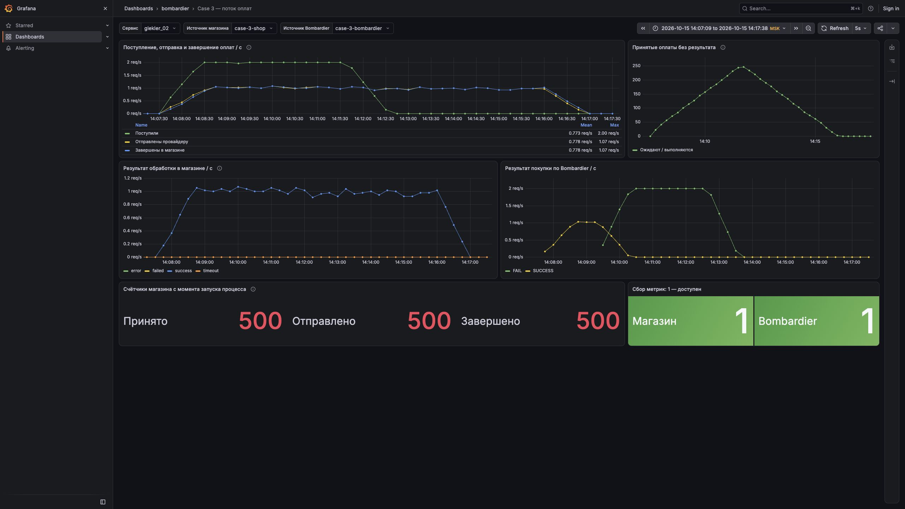
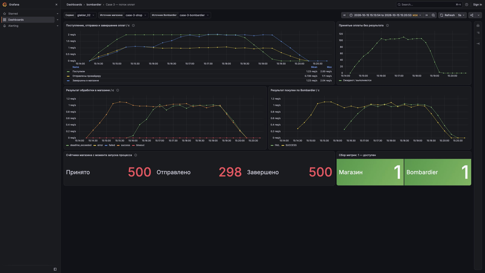

# Кейс №3: очередь при недостаточной пропускной способности

Локально проверено: успешные покупки выросли **105 → 298 из 500**, расходы
уменьшились **15 000 → 8 940**. Семь тестовых случаев прошли. Результаты
удалённой проверки публикуются отдельно в описании PR; локальный результат
не является подтверждением приёмки на учебном стенде.

## Условия и факты

Нагрузка: `ratePerSecond = 2`, `testCount = 500`, `processingTimeMillis = 60000`,
единственный платёжный аккаунт — `acc-5`. Подача 500 запросов занимает примерно
250 секунд; от первого до последнего при точном интервале 0,5 с — 249,5 секунды.

15 октября 2026 года read-only запрос `/external/accounts` подтвердил одинаковые
параметры локального Bombardier и учебного стенда:

| Параметр | Значение |
| --- | ---: |
| Одновременные обращения | 5 |
| Лимит частоты отправки | 3/с |
| Среднее время обработки | 4,9 с |
| Цена обращения | 30 учебных единиц |

`processingTimeMillis` — бюджет обработки покупки в тесте. Это не время одного
обращения к провайдеру: последнее задаётся отдельно через `averageProcessingTime`.
В приложении тестовый дедлайн передаётся до адаптера, но исходный алгоритм case-2
его не проверяет.

## Расчёт до эксперимента

Обозначения: входящий поток λ = 2/с, число слотов C = 5, среднее обслуживание
S = 4,9 с. Оценка максимальной пропускной способности:

```text
μ = min(лимит частоты, C / S) = min(3, 5 / 4,9) ≈ 1,02 оплаты/с
λ × S = 2 × 4,9 = 9,8 одновременно выполняющихся обращений
λ − μ ≈ 0,98 оплаты/с — скорость роста очереди
```

Для устойчивой обработки без накопления очереди потребовалось бы около 10 слотов,
но контракт аккаунта разрешает только 5. Увеличение числа потоков магазина или
превышение семафора это ограничение не решает.

В приближении постоянного времени обслуживания:

| Нагрузка | Подача запросов | Накопившаяся очередь | Ожидание в конце | Ожидание + обслуживание |
| --- | ---: | ---: | ---: | ---: |
| Case 2: 100 при 2/с | ≈50 с | ≈49 | ≈48 с | ≈52,9 с |
| Case 3: 500 при 2/с | ≈250 с | ≈245 | ≈240 с | ≈244,9 с |

Это объясняет, почему короткий тест может проходить при той же скорости,
а длинный выходит за бюджет 60 с. Оценка не учитывает разгон, сетевые задержки,
сохранение событий и разброс времени провайдера; её нужно сравнить с измерениями.

500 обращений требуют в среднем `500 × 4,9 = 2450` слот-секунд работы. Даже
оптимистичное окно до последнего клиентского дедлайна даёт примерно
`5 × (250 + 60) = 1550` слот-секунд, или около 316 завершений при S = 4,9 с.
Это ориентир модели по среднему времени, а не строгая верхняя граница для
случайных длительностей и не обещание 316 успешных покупок. Для 500/500 при таком
среднем времени ресурсов не хватает.

## Собственные счётчики

| Метрика Prometheus | Момент увеличения |
| --- | --- |
| `shop_payment_received_total{service}` | Покупка передана в обработку магазина, до ожидания рабочего потока |
| `shop_payment_submitted_total{service,account}` | Получены разрешения семафора и ограничителя частоты; начинается HTTP-попытка |
| `shop_payment_completed_total{service,account,result}` | Записан результат: `success`, `failed`, `timeout`, `error` или отказ до отправки `deadline_exceeded` |

Идентификаторы покупателей, заказов и запросов в метках не используются.
Счётчики заранее зарегистрированы, включая нулевые результаты. Ошибка сохранения
события может оставить покупку без `completed`: разницу не следует скрывать.

Дашборд **Case 3 — поток оплат** содержит входящий/исходящий/завершённый поток в
секунду, число принятых покупок без результата, исходы обработки магазина,
исходы покупок по Bombardier и проверку `up` обоих источников.

При одном аккаунте и одном процессе `received − completed` показывает очередь
вместе с выполняемыми оплатами. После перезапуска процесса нельзя сравнивать
накопленные значения с предыдущим запуском. `completed{result="success"}`
означает успешное обращение к провайдеру, а не соблюдение клиентского дедлайна.

Для графиков используется `rate()` от собственных счётчиков, как рекомендует
[документация Micrometer](https://docs.micrometer.io/micrometer/reference/concepts/counters.html).
Точные итоги прогона берутся по разнице сырых значений до и после теста:
`increase()` на графике может давать дробные значения из-за экстраполяции.

## Воспроизводимый локальный стенд

`docker-compose.case-3.yml` поднимает отдельные магазин, Postgres, Bombardier,
Prometheus и Grafana. Его необходимо запускать с именем проекта `highload-case3`.
Для него создаются собственные тома; существующий стенд не используется как база.
Магазин локально собирается и запускается как `linux/amd64`: исходный runtime-образ
Java не предоставляет вариант для ARM64 Mac. При сравнении локальных и удалённых
результатов учитывается эмуляция архитектуры.

| Компонент | Адрес на Mac |
| --- | --- |
| Магазин | `http://127.0.0.1:8081` для генератора; `http://127.0.0.1:18083` для наблюдения |
| Bombardier | `http://127.0.0.1:11234` |
| Prometheus | `http://127.0.0.1:19093` |
| Grafana | `http://127.0.0.1:13003` |

Prometheus собирает ровно один источник магазина и один источник Bombardier.
Перед тестом оба должны иметь `up = 1`, все три счётчика магазина должны быть
доступны, а предыдущие покупки и прогоны — завершены. Docker-порты опубликованы
только на loopback Mac. Учётные данные поступают из существующего окружения,
не из документации или снимков результатов.

Учётная запись возвращает генератору адрес `http://host.docker.internal:8081`,
поэтому магазин также публикуется на loopback-порту 8081. Одного
`TEST_SERVICE_IP=shop` недостаточно: фактический адрес берётся из дескриптора
сервиса. Первая попытка запуска это выявила: генератор вернул HTTP 200, но создание
пользователя завершилось `ConnectException`; покупки не запускались. Эта попытка
сохранена отдельно как ошибка подготовки стенда и не считается результатом кейса.

В первой подготовке Grafana была остановлена OOM-killer. Для отдельного локального
стенда ограничена её память, отключены предустановка/обновление и загрузка
ненужных плагинов; Prometheus остаётся включён. Доступность самой Grafana записывается
в результат отдельно от обязательной доступности обоих источников метрик.

## Результаты

| Прогон | Успешные покупки | Неуспешные | Обращения к провайдеру | Расходы | Доказательства |
| --- | ---: | ---: | ---: | ---: | --- |
| Исходный локальный | 105/500 (21%) | 395 | 500 | 15 000 | [Сырые счётчики и ход прогона](case-3-local-baseline-02.json) |
| Итоговый локальный | 298/500 (59,6%) | 202 | 298 | 8 940 | [Сырые счётчики и ход прогона](case-3-local-after.json) |

Исходный прогон: **15.10.2026, 14:07:24–14:16:09 МСК**. Сборщик дождался пустой
очереди; это около 525 с наблюдения. Все клиентские тесты завершились примерно
на 313-й секунде. После этого магазин отправил ещё 189 платных обращений.

Причины неуспешных покупок: 394 `CLIENT_TIMEOUT` и 1 `TIMEOUT`. При этом все
500 обращений к самому провайдеру завершились успешно; таймаутов HTTP-клиента
магазина не было. Эти два результата описывают разные участки процесса.

Суммарное время обработки провайдером — 2 473 357 мс, среднее — **4,946714 с**,
близко к заявленным 4,9 с. Значения `external_sys_duration_sum/count` приведены
в [отдельном снимке](case-3-local-baseline-provider.txt); у этого счётчика единица
измерения — миллисекунды.

Пик незавершённых оплат по снимкам каждые 10 с — **251**. Доход — 39 906 учебных
единиц, расходы — 15 000, разница — 24 906. При одном обращении на покупку
395 несвоевременных результатов стоили `395 × 30 = 11 850`, или 79% расходов.
Цена одной своевременно успешной покупки с учётом всех обращений — 142,86.



[Grafana: исходный интервал](http://127.0.0.1:13003/d/case-3-payments?from=1792062429169&to=1792063058963&var-service=glekler_02&var-shop_job=case-3-shop&var-provider_job=case-3-bombardier).
Локальная ссылка доступна при работающем отдельном стенде на Mac.

## Проверенное изменение

После ожидания семафора и повторно после ожидания ограничителя частоты адаптер
проверяет остаток до дедлайна. Если его недостаточно, записываются
`logSubmission(false)` и `logProcessing(false)`, а счётчик завершений получает
результат `deadline_exceeded`. Платный HTTP-вызов не выполняется, слот освобождается
через существующий `finally`, и очередь переходит к более свежей покупке.

Резерв равен максимуму среднего времени провайдера и уже действующего read timeout
HTTP-клиента. В этом кейсе это **10 с**: у используемого
[OkHttp 4.12.0](https://github.com/square/okhttp/blob/parent-4.12.0/okhttp/src/main/kotlin/okhttp3/OkHttpClient.kt#L191)
read timeout по умолчанию 10 000 мс, а среднее обслуживание 4,9 с. Резерв даёт
запас на разброс времени; это выбранная политика допуска, не строгая гарантия
полного времени HTTP-вызова. Read timeout не ограничивает суммарно DNS,
соединение, запись и чтение ответа.

Лимиты 5 параллельных вызовов и 3/с сохраняются. Уже отправленные операции не
отменяются ради освобождения слота: отмена клиента не доказывает остановку
обработки у провайдера. Внешний HTTP-контракт магазина сохраняется.

Пройдены семь тестовых случаев: три границы бюджета, обычная успешная
оплата, истечение бюджета за семафором, истечение за rate limiter и освобождение
слота после транспортного таймаута. Они используют управляемые часы и HTTP-двойник;
проверка на настоящем генераторе подтверждена локальным прогоном ниже.
[Сводка сборки и тестов](tests.txt).

## После изменения

Итоговый локальный прогон: **15.10.2026, 15:14:09–15:19:23 МСК**, около 314 с
наблюдения до завершения всех покупок и обработки очереди.

| Метрика | До | После |
| --- | ---: | ---: |
| Успешные покупки | 105 (21%) | 298 (59,6%) |
| Платные обращения | 500 | 298 |
| Отказы до обращения | 0 | 202 |
| Неуспешные/опоздавшие среди оплаченных обращений | 395 | 0 |
| Пик незавершённых оплат, снимки каждые 10 с | 251 | 107 |
| Расходы | 15 000 | 8 940 |
| Доход | 39 906 | 121 301 |
| Доход минус расходы | 24 906 | 112 361 |
| Доход / расходы как доли их суммы | 72,68% / 27,32% | 93,14% / 6,86% |
| Расход на своевременно успешную покупку | 142,86 | 30 |
| Среднее обслуживание провайдером | 4,946714 с | 4,880983 с |

Собственные счётчики после прогона: принято 500, отправлено 298, завершено 500,
включая 298 `success` и 202 `deadline_exceeded`. Ошибок и транспортных таймаутов
магазина нет. В Bombardier 298 успешных покупок и 202 `CLIENT_TIMEOUT`:
отклонённые магазином покупки не оплачивались, а клиентская проверка дождалась
своего дедлайна. Это не 100% успешных покупок; знаменатель по-прежнему 500.



[Grafana: итоговый интервал](http://127.0.0.1:13003/d/case-3-payments?from=1792066434056&to=1792066853020&var-service=glekler_02&var-shop_job=case-3-shop&var-provider_job=case-3-bombardier).
Интервалы скриншотов включают 15 с до начала и около 90 с после завершения,
чтобы было видно возвращение потока и очереди к нулю.

Цены покупок и длительности провайдера меняются между прогонами. Доходы приведены
как наблюдённые значения, а не как гарантированный финансовый эффект. Количество
обращений, их фиксированная цена 30 и исходы покупок сопоставляются отдельно.

## Ограничения вывода и сдача

В [общем руководстве курса](https://andrsuh.notion.site/2595d535059281d8a815c2cb3875c376)
указан ориентир более 97% успешных тестов. Он здесь **не достигнут**. В модели
описанного одиночного `POST /external/process` заданные 2 покупки/с превышают
пропускную способность аккаунта примерно вдвое. Расчёт по среднему времени
показывает оптимистичный ориентир около 316 завершений; он не является строгой
границей для случайных длительностей. 298/500 нельзя выдавать за прохождение
97-процентного критерия или доказательство глобально оптимального решения.

Резерв 10 с выбран консервативно. Его уменьшение могло бы увеличить число
отправок, но без распределения задержек нельзя обещать сохранение нулевого числа
платных опозданий. Для защиты нужно показать ограничение мощности, сокращение
бесполезных расходов и отдельно согласовать применение общего KPI к этому кейсу.

Локальные before/after запущены с одинаковыми параметрами и фактическим локальным
значением по умолчанию `testSuccessByThePaymentFact=false`. В OpenAPI удалённого
launcher это значение по умолчанию `true`; его семантика в прочитанных материалах
не раскрыта. Удалённый результат следует фиксировать отдельно с фактическими
параметрами, без изменения режима ради улучшения оценки.
