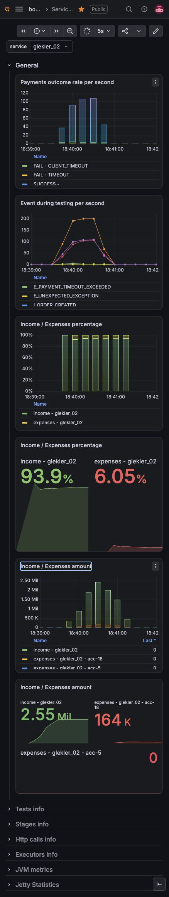
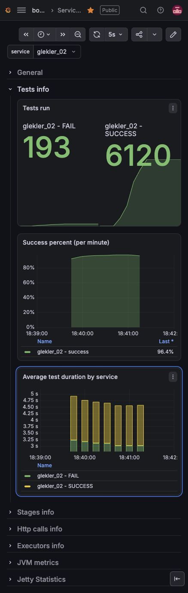
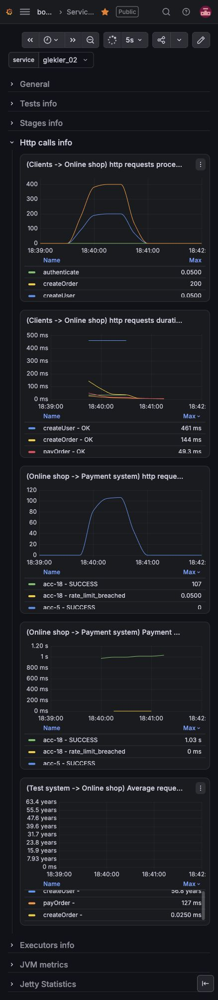

# Кейс 4: буферизация и back pressure

Изменения основаны на [кейсе 3, PR #5](https://github.com/Anastaia0/high-load-course/pull/5).
Идеи ограниченной очереди, выбора платежей и размера пула взяты из
[примера PR #226](https://github.com/andrsuh/high-load-course/pull/226).

## Параметры проверки

| Параметр | Значение |
| --- | --- |
| Аккаунт | `acc-18` |
| Входящая нагрузка | 200 запросов/с |
| Количество запросов | 6000 |
| Дедлайн | 3000 мс |
| Ёмкость очереди | 110 ожидающих задач |

Шаблон удалённого запроса — `test-case-4.http`. Имя сервиса и токен подставляются
из локального окружения HTTP-клиента. Удалённо проверяется только ветка `case-4`.
Кейс 3 используется исключительно как база изменений, повторно не запускается.

## Обработка платежей

- Один настроенный аккаунт. Число обработчиков определяется его частотой,
  средней длительностью обработки и лимитом параллельных запросов.
- Очередь ограничена `PAYMENT_QUEUE_CAPACITY`, по умолчанию 110.
  Переполнение даёт HTTP 429 с `Retry-After: 1`, без изменения статуса заказа.
- Среди ещё выполнимых платежей приоритет у большей суммы; при равенстве —
  у более свежего запроса. Пригодность проверяется заново при извлечении.
- Просроченные задачи остаются доступными для записи событий отказа и не
  отправляются провайдеру. Принятые задачи не вытесняются из очереди.
- Частота ограничена скользящим секундным окном. Ожидание ограничений допускается
  только до `deadline - averageProcessingTime`.
- После отправки слот занят до окончания HTTP-вызова и чтения ответа.
  Поздняя успешная оплата сохраняется как успех провайдера и отдельно учитывается
  в метрике `success_after_deadline`. Повторы платежей не выполняются.

## Метрики

У метрик есть метка `service`; у метрик провайдера также есть `account`.

| Метрика Micrometer | Назначение |
| --- | --- |
| `shop.payment.received` | Попытки приёма платежей |
| `shop.payment.admission.rejected` | Отказы при заполнении очереди или остановке |
| `shop.payment.queue.size` | Ожидающие задачи |
| `shop.payment.workers.active` | Занятые обработчики |
| `shop.payment.task.completed` | Завершённые локальные задачи, включая отказы |
| `shop.payment.dispatch.errors` | Необработанные ошибки выполнения задач |
| `shop.payment.provider.inflight` | Незавершённые HTTP-запросы |
| `shop.payment.provider.waiters` | Ожидающие разрешения параллельности |
| `shop.payment.provider.duration` | Время HTTP-вызова и чтения ответа |
| `shop.payment.queue.wait` | Ожидание до отправки или локального отказа |
| `shop.payment.attempts` | Исходы: вовремя, поздно, просрочено, прервано, отказ или неизвестный результат |

## Результаты

Локальная проверка 22 октября 2026 года: `mvn verify` в образе
`maven:3.9.9-eclipse-temurin-17` завершилась успешно. Пройдено 19 тестов,
ошибок и пропусков нет; исполняемый JAR собран.

Проверены порядок и ёмкость очереди, HTTP 429 без изменения заказа,
остановка приёма, скользящее окно при конкурентных обращениях, истечение
дедлайна во время ожидания, поздний ответ, ошибки HTTP/транспорта и освобождение
разрешений провайдера. Провайдер и хранилище событий в тестах изолированы.

### Удалённый прогон кейса 4

- Дата: 22 октября 2026 года; сервис `glekler_02`, аккаунт `acc-18`.
- Проверенный коммит: `a9884393c433343f623fb9ef9f56582bdea07b84`.
- Стенд подтвердил сборку `origin/case-4`, образ `glekler_02-1792683523`.
- Контейнер: `4787c855c45f1cdf0145fa8833dc9ad17ede364742f467e09767374086859513`.
- Интервал графиков: **18:39–18:42 МСК** (`15:39–15:42 UTC`).
- Фактические параметры аккаунта: 110 запросов/с, средняя обработка 1 с,
  лимит параллельности 10 000. Приложение использует 111 обработчиков и буфер 110 задач.

[Открыть Grafana для этого прогона](http://77.234.215.138:33000/d/KVr-Vmpnz/services-statistic?orgId=1&from=1792683540000&to=1792683720000&timezone=Europe%2FMoscow&var-service=glekler_02)
· [Логи запуска](http://77.234.215.138:34321/logs/4787c855c45f1cdf0145fa8833dc9ad17ede364742f467e09767374086859513?tail=500)

| Показатель | Приращение за интервал |
| --- | ---: |
| Успешные тесты | 5780 |
| Неуспешные тесты | 182 |
| Из них `CLIENT_TIMEOUT` | 177 |
| Из них `TIMEOUT` | 5 |
| Завершения, учтённые в `test_duration_count` | 5962 |
| HTTP-ответы на оплату `OK` | 5962 |
| HTTP-ответы на оплату `429` | 5183 |
| Успехи провайдера | 5861 |
| Ответы провайдера `rate_limit_breached` | 3 |
| Доход | 2 406 529 |
| Расходы | 175 920 |
| Доход минус расходы | 2 230 609 |

5780 успешных тестов — **96,33% от заданных 6000**. Счётчик завершений содержит
5962 результата: причину разницы в 38 результатов по доступным метрикам не
устанавливаем. HTTP 429 учитывает попытки запросов, поэтому эти 5183 ответа
нельзя складывать с числом уникальных тестов.

Результат не является 100% успешностью или доказательством полного отсутствия
превышений лимитов: провайдер зарегистрировал три `rate_limit_breached`.

Числа в таблице получены разностью накопительных счётчиков на границах интервала
через instant-запрос с `offset 3m`. Отсутствующая начальная серия считается нулём.
Штатные панели используют `increase()` с экстраполяцией и округлением, поэтому
на скриншотах панель `Tests run` показывает другие числа. Точные значения и
ссылки на запросы сохранены в [result.json](result.json) и [explore-links.json](explore-links.json).

### Графики удалённого запуска

Исходы оплат и финансовые показатели:

Успешность и длительность тестов:

Частота HTTP-запросов и длительности:

